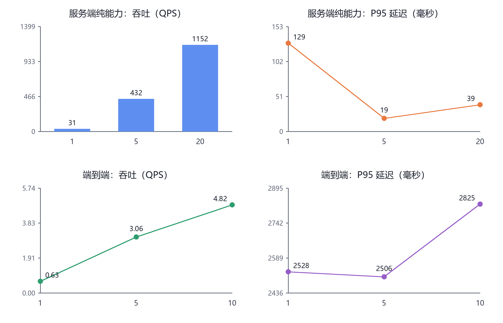

# 性能与限流实验

日期：2026-11-25　　环境：单机（Windows 11 / JDK 25 / Spring Boot 3.5 内嵌 Tomcat）　　客户端与服务端同机回环

## 一、实验设计

压测不能只看一个数。这里拆成三组，分别回答三个问题：

| 组 | 问题 | 做法 | 为什么要这么设计 |
| --- | --- | --- | --- |
| A | 我们自己的服务端能扛多少？ | 把 `bm25-min-score` 调到 100000，让检索必然返回空 → 直接拒答、**不调用大模型** | 排除上游模型，否则测出来的是 DeepSeek 的吞吐，不是我们的 |
| B | 端到端在真实模型下是什么水平？ | 正常提问，调用 DeepSeek | 这才是用户感知到的能力 |
| C | 限流到底生不生效？ | 默认配置（30 次/分）下突发 40 次请求 | 顺序请求时令牌边消耗边补充，测不出限流 |

工具：`tools/load_test.py`（Python 线程并发 + 百分位统计），驱动：`tools/run_load_suite.py`（自动起停服务），原始数据：`eval/load-results.json`。

## 二、结果

**组 A　服务端纯能力（无模型参与）**

| 并发 | 请求数 | QPS | P50 | P95 | P99 | 失败 |
| --- | --- | --- | --- | --- | --- | --- |
| 1 | 10 | 31.3 | 28 ms | 129 ms | 129 ms | 0 |
| 5 | 50 | 431.6 | 9 ms | 19 ms | 29 ms | 0 |
| 20 | 100 | **1152.5** | 10 ms | 39 ms | 56 ms | 0 |

> 并发 1 那行的 129 ms 是**冷启动**：首个请求要建 BM25 索引（587 块），后续请求降到 10 ms 量级。
> 这也说明索引"按需构建 + 版本号失效"的设计在首次请求上确实有代价，但只付一次。

**组 B　端到端（真实调用 DeepSeek）**

| 并发 | 请求数 | QPS | P50 | P95 | P99 | 失败 |
| --- | --- | --- | --- | --- | --- | --- |
| 1 | 10 | 0.63 | 1549 ms | 2528 ms | 2528 ms | 0 |
| 5 | 20 | 3.06 | 1620 ms | 2506 ms | 2506 ms | 0 |
| 10 | 20 | 4.82 | 1558 ms | 2825 ms | 2825 ms | 0 |

**组 C　限流验证（30 次/分，突发 40 次）**

| 成功 | 被限流（429） | 其他失败 | 用时 |
| --- | --- | --- | --- |
| 32 | **8** | 0 | 6.13 s |

40 次请求里通过 32 次：容量 30 + 6 秒内按 0.5/s 补进来的约 2 个令牌，与令牌桶语义完全吻合。

## 三、结论

1. **服务端不是瓶颈，而且差着三个数量级。** 1152 QPS vs 端到端 4.8 QPS。
   检索、拼提示词、序列化这些自研部分加起来不到 10 ms（P50），
   真正的时间花在等模型。这也解释了为什么"优化代码"对端到端延迟几乎无效，
   流式输出和上下文裁剪才是能改善体验的地方。

2. **端到端吞吐不受我们控制。** 并发 1→5 时 QPS 涨了 4.9 倍（近乎线性），
   但 5→10 只涨了 58%（3.06→4.82）。并发翻倍而吞吐只增六成，说明请求在上游排队，
   继续加并发只会把 P95 拉长（2506→2825 ms），不会提高吞吐。

3. **感知延迟比完成延迟重要。** 端到端 P50 约 1.6 秒，但流式首字只要 184 ms（见 BASELINE 实验）。
   同样的后端起因，用户感受差 8 倍。这是报告里"Why SSE"最硬的理由。

4. **限流生效且行为可预测。** 容量 30、补充 0.5/s，突发 40 次精确地放过 32 次。

## 四、一个必须写进报告的设计隐患

限流按 **IP** 计数。教室或宿舍常在同一 NAT 后面，几十个学生共用一个出口 IP，
30 次/分会被瞬间打满，**一个人提问会把全教室挡在门外**。

真实部署应该：
- 按登录用户 ID 限流，IP 只做粗粒度兜底；
- 或把容量调大、补充速率按班级规模估算；
- 同时把 `429` 的 `Retry-After` 用起来，前端做友好提示而不是报错。

这是"功能正确 ≠ 场景正确"的典型例子，写进报告比只放一张 QPS 图有价值。

## 五、局限

- 单机、本机回环，没有经过真实网络，网络损耗被完全排除；真实环境延迟会更高。
- 组 B 每组只有 20 个请求，P99 的样本量不足（20 个点算 P99 意义有限），只看 P50/P95。
- 上游模型延迟随时段波动，组 B 的绝对值不可跨时段比较，只能看组内相对变化。
- 未测试 SSE 长连接占用（并发流式连接的连接数上限、断连回收）——这是下一轮要补的。
