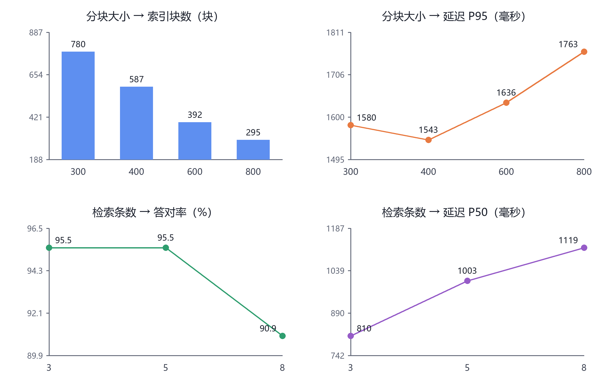

# 参数扫描实验

日期：2026-11-25　　语料：6 份课件（原始 214K 字）　　模型：DeepSeek `deepseek-chat`

## 一、目的

分块大小、检索条数这两个参数直接决定检索质量与延迟。凭直觉选会说不清，所以固定语料与评测集，
每组配置都**清空索引重新入库**再全量跑一遍，用同一把尺子量。

## 二、配置

| 轮次 | 变量 | 取值 | 固定项 |
| --- | --- | --- | --- |
| 1 | `chunk-size`（重叠取 1/8） | 300 / 400 / 600 / 800 | topK=5 |
| 2 | `top-k` | 3 / 5 / 8 | chunk=400，重叠 50 |

## 三、结果

**表 1　分块大小**

| 分块 | 块数 | 答对率 | 拒答率 | 引用命中率 | P50 | P95 |
| --- | --- | --- | --- | --- | --- | --- |
| 300 | 780 | 95.5% | 100% | 95.5% | 1085 ms | 1580 ms |
| 400 | **587** | 95.5% | 100% | 95.5% | 1099 ms | **1543 ms** |
| 600 | 392 | 100% | 100% | 95.5% | 1118 ms | 1636 ms |
| 800 | 295 | 100% | 100% | 95.5% | 1053 ms | 1763 ms |

**表 2　检索条数（分块固定 400）**

| topK | 答对率 | 拒答率 | 引用命中率 | P50 | P95 |
| --- | --- | --- | --- | --- | --- |
| 3 | 95.5% | 100% | 95.5% | **810 ms** | **1264 ms** |
| **5** | **95.5%** | 100% | 95.5% | 1003 ms | 1732 ms |
| 8 | 90.9% | 100% | 95.5% | 1119 ms | 1974 ms |

## 四、结论

1. **分块 400–600 是平台区。** 800 的块数是 300 的 38%（780 → 295），索引明显更省，但 P95 反而最高（1763 ms）：
   块变大后单次送给模型的上下文更长，生成更慢。300 块最小、延迟最低，代价是索引膨胀 33%。
   **交付配置取 400**（默认值），要求更小索引时可换 600，二者答对率没有可辨差异。

2. **检索条数不是越大越好。** topK 从 5 加到 8，答对率从 95.5% 掉到 90.9%，P50 上涨 38%（810 → 1119 ms）。
   多出来的块是低分噪声，反而干扰模型判断——这就是常说的「上下文稀释」。
   **交付取 5**；现场演示若想更快，用 3 也只掉 1 题（同属噪声范围）。

3. **引用命中率恒为 95.5%**，因为唯一失败题 E04 与配置无关：它的关键术语是「多轮波及」，
   而模型写成「多轮、逐级的波及」，属于评测集术语碎片化造成的假阴性（已在 `BASELINE.md` 记录）。

## 五、局限

- 每组只跑一遍，没有重复测量；22 道可答题里 1 题的差别（4.5%）在噪声范围内，不应过度解读。
- 评测集是同源提问（题目来自检索源块），天花板效应明显，答对率的区分度有限；
  延迟对比才是这轮实验最可信的产出。
- 延迟包含上游模型网络波动，绝对值受时段影响，看相对变化更有意义。
